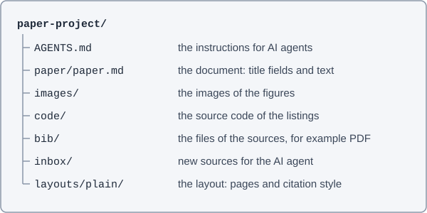

# Abstract {AST}

This file is the empty paper document of the built-in layout `plain` of nimblescape Markdown Paper. A new document of the layout starts with this text. The chapters explain how to work with the document, with example texts. Replace them with the text of your document. The file `document.pdf` in the folder of the layout shows the pages of this file as a PDF.

# Contents {TOC}

<!-- toc -->
- [Abstract](#abstract-ast)
- [1 Working with this layout](#working-with-this-layout)
- [1.1 What you need](#what-you-need)
- [1.2 The folders of the project](#the-folders-of-the-project)
- [1.3 The title block](#the-title-block)
- [2 Writing text](#writing-text)
- [2.1 Paragraphs and emphasis](#paragraphs-and-emphasis)
- [2.2 Headings](#headings)
- [2.3 Footnotes](#footnotes)
- [3 Figures, tables and code](#figures-tables-and-code)
- [3.1 Figures](#figures)
- [3.2 Tables](#tables)
- [3.3 Code](#code)
- [4 Sources and citations](#sources-and-citations)
- [4.1 Sources](#sources)
- [4.2 Citing](#citing)
- [5 Notes and collaboration](#notes-and-collaboration)
- [6 Pages and PDF](#pages-and-pdf)
- [6.1 Page preview](#page-preview)
- [6.2 Checks and format](#checks-and-format)
- [6.3 Export PDF](#export-pdf)
- [References](#references-bib)
- [List of Figures](#list-of-figures-lof)
- [List of Tables](#list-of-tables-lot)
- [List of Listings](#list-of-listings-lol)
- [Appendix](#appendix-apx)
- [Appendix: An appendix](#an-appendix)
<!-- /toc -->

# Working with this layout

The layout `plain` makes A4 pages with a title block on the first page, numbered headings, the author and the page number in the footer, and the footnotes at the foot of each page. The keys in this file are the keys of Windows and Linux; on a Mac, press Cmd instead of Ctrl.

## What you need

- [Visual Studio Code](https://code.visualstudio.com/) (VS Code), a free editor for Windows, macOS and Linux.
- The extension [nimblescape Markdown Paper](https://github.com/nimblescape/markdownpaper-vscode) for VS Code. It shows the pages of the document in the preview, checks the file and makes the PDF.
- The extension [nimblescape Markdown Notes](https://github.com/nimblescape/markdownnotes-vscode) for VS Code. It manages notes, footnotes, figures, tables and listings, and formats the file.
- Google Chrome, Chromium or Microsoft Edge. Markdown Paper prints the PDF with one of these browsers.
- [Node.js](https://nodejs.org/) 22 or later, only for the commands on the command line, for example for an AI agent.
- [Git](https://git-scm.com/) and an account on [GitHub](https://github.com/), when you keep the versions of the document or work with other people.

## The folders of the project

A project is a folder with the document and everything that it needs. The command `npx -y @nimblescape/markdownpaper create` on the command line or "Markdown Paper: New Project" in VS Code makes a new project. Both ask for the layout and offer the layouts on GitHub for a choice. [Figure 1](#fig-folders-project) shows the folders.

Figure 1: The folders of a project <a id="fig-folders-project"></a>



Open the folder of the project in VS Code ("File", "Open Folder") and then the file `paper/paper.md`.

## The title block

The title block comes from the fields at the start of the file, the front matter between the two lines `---`. Write the value of each field after the colon, in quotes:

```yaml
title: "Learning with Feedback in Vocational School"
author: "First name Last name"
date: "1 June 2026"
```

The line with `#` above each field describes the field. When the mouse pointer in VS Code is on the name of a field, VS Code shows this description. A field without a value that the layout requires gets a yellow line in VS Code, and the view "Problems" (Ctrl+Shift+M) shows all warnings. A field without a value, such as `subtitle`, does not show on the page.

# Writing text

The document is a text file in Markdown. Markdown is a simple way to write text: characters such as `#`, `*` and `-` mark a heading, an emphasis or a list. GitHub shows the file as text with headings, and Markdown Paper makes the pages of the layout from it.

## Paragraphs and emphasis

- Write each paragraph on one line. An empty line separates two paragraphs.
- `**bold**` becomes **bold**, `*italic*` becomes *italic*.
- A line that starts with `- ` is an item of a bulleted list. A line that starts with `1. ` is an item of a numbered list.
- A line that starts with `> ` is a block quote.
- Markdown Paper hyphenates the text by the rules of the language of the layout. Do not write hyphens to break a word.

## Headings

`#` is a chapter, `##` a section and `###` a subsection. Markdown Paper numbers them: 1, 1.1, 1.1.1. Do not write the numbers. A heading with `{-}` at its end gets no number.

Markdown Paper knows some headings by their words: Abstract, Contents, List of Figures, List of Tables, List of Listings, References and Appendix. They get no number, and the table of contents does not list itself. A code in curly brackets at the end of such a heading names its kind in every language, for example `# References {BIB}`; the code does not show on the pages. The headings of this file have their codes, so they also work in a document in another language.

A reference to a chapter is a link with a word and a number, for example `[Chapter 3.1](#figures)`: the text after `#` is the heading in small letters, with `-` in place of the spaces. The pages always show the current number, for example [Chapter 3.1](#figures). In VS Code, the command `/ref` writes such links: type `/ref` and choose the target from the list.

## Footnotes

A footnote has a reference in the text and its text on a line of its own:

```markdown
The interviews are recorded.[^1]

[^1]: The persons agree to the recording in writing.
```

The text of the footnote is at the foot of the page of its reference.[^example] Markdown Paper numbers the footnotes in the order of their references. In VS Code, `/footnote` after a word writes a new footnote, and the side view "Notes" shows all footnotes of the file to read and edit them.

[^example]: This is a footnote.

# Figures, tables and code

## Figures

A figure is an image in a paragraph of its own, with its caption in the paragraph before it:

```markdown
Figure 1: The folders of a project <a id="fig-folders-project"></a>


```

To add a figure:

1. Put the file of the image into the folder `images/` of the project, for example as PNG, JPEG or SVG. In VS Code, you can also drag an image into the text with the Shift key pressed, or paste it from the clipboard; VS Code then puts the file into the project.
2. Type `/figure` in an empty line and choose the image from the list. Markdown Notes writes the caption and the image.
3. Write the text of the caption. The formatter writes the number when you save the file.
4. Write an alternative text between the square brackets: a sentence that describes the image for persons who cannot see it.

The path in the parentheses leads from the file of the document to the image. The anchor `<a id="…">` at the end of the caption is the name of the figure for references: `[Figure 1](#fig-folders-project)` becomes [Figure 1](#fig-folders-project) on the pages, also when the number changes. `/ref` writes such references and the anchor. An image without a caption, for example a logo, gets no number.

## Tables

A table is made of lines with `|` between the columns. The second line separates the header row from the content. The caption is in the paragraph directly before the table:

```markdown
Table: Participants by grade

| Grade | Number |
| --- | --- |
| 10 | 12 |
| 11 | 9 |
```

Type `/table` in an empty line: Markdown Notes writes a table with two columns and its caption. The formatter writes the number of the caption, as for figures. The columns do not need to line up. [Table 1](#tab-markdown-elements) is an example.

Table 1: The elements of Markdown and their look on the pages <a id="tab-markdown-elements"></a>

| Markdown | On the pages |
| --- | --- |
| A paragraph without a mark | Text in a serif font, justified, with hyphenation |
| `# Chapter` | A numbered heading in a sans-serif font |
| `> Quote` | A block quote with a margin on the left |
| `- Item` | An item of a bulleted list |
| `Figure 1: Text` | A caption with its number |

## Code

Short code goes into a code block between two lines with three backticks. The name of the language after the first backticks colors the code in VS Code:

````markdown
```python
print("Hello")
```
````

Code from a file of the project is a listing with a number and a caption. Type `/listing` in an empty line, choose the file, and then the whole file or a function. Markdown Notes writes the caption with a link to the lines of the file, a comment with the source, and the code. The formatter writes the code again from the file each time you save, so the listing stays current. Change the code of a listing in its file, not in the document. [Listing 1](#lst-mean-grades) shows a function of the file `code/mean.py` of the project.

Listing 1: [The mean of the grades](code/mean.py#L5-L7) (mean.py, L5-L7)<a id="lst-mean-grades"></a>

<!-- listing: code/mean.py#mean -->

```python
def mean(grades):
    """Returns the mean of a list of grades."""
    return sum(grades) / len(grades)
```

A heading `# List of Listings {LOL}` adds the list of the listings.

# Sources and citations

## Sources

The data of the sources is in a comment at the end of the file, which the pages and GitHub do not show. Each line is one source with its ID, for example `hattie2007`. Do not write this data yourself: an AI agent adds a source with the command `markdownpaper source`, which takes the data from doi.org, from the catalogs of the libraries, from PubMed, from arXiv or from a web page:

```sh
npx -y @nimblescape/markdownpaper source paper/paper.md 10.3102/003465430298487
```

Put the file of a source, for example a PDF, into the folder `inbox/`. An AI agent reads it, adds its data, and moves it to the folder `bib/` with the ID as its name, for example `bib/hattie2007.pdf`.

## Citing

A citation is a link to the ID of the source. The title of the link in quotes names the place in the source:

```markdown
Feedback has a strong effect on learning ([Hattie & Timperley, 2007, p. 81](#hattie2007 "page 81")).
[Hattie and Timperley (2007)](#hattie2007 "narrative") describe four levels.
```

Feedback has a strong effect on learning ([Hattie & Timperley, 2007, p. 81](#hattie2007 "page 81")). The formatter writes the text of each citation and the entries of the references when you save the file, in the citation style of the layout, APA 7. A citation of a source without data gets a yellow line in VS Code.

# Notes and collaboration

Markdown Notes adds notes to a place in the text, for example a question to the supervisor or a task for later. A note is a footnote with an ID such as `note-7k2q` and a header line with the name and the time. The pages and the PDF do not show notes. GitHub shows them as footnotes at the end of the file.

- **Add a note:** select the text and press Shift+Alt+N, or click the light bulb and then "Add Note". Write the note in the side view "Notes".
- **Reply:** each note is a conversation. Several persons can reply, also to a reply.
- **Tasks:** `/todo` at the end of a sentence writes a note with a box to tick.
- **Colors and filters:** each note has a color. The filters of the side view show only the open tasks, one color, or the notes with certain words.
- **Name:** with the sign-in to GitHub in VS Code, each note has your name on GitHub.

VS Code opens a file with notes in a clean view, which shows the text without the marks of the notes. With Git and GitHub, you keep each version of the document and share it with other persons.

# Pages and PDF

## Page preview

The preview of VS Code shows the pages of the document as they are in the PDF. Press Ctrl+K and then V for the preview beside the text, or click the book ("Show Page Preview") at the top right of the editor. The preview follows each change after a short pause. A double click on a paragraph of the preview shows its line in the text.

## Checks and format

VS Code checks the file while you write and marks problems with a yellow line: a missing field of the title block, a reference to a figure that does not exist, or a citation without a source. When you save, and with "Format Document" (Shift+Alt+F, on Linux Ctrl+Shift+I), Markdown Notes formats the file: it writes the numbers of the captions and of the references, the table of contents, the lists of figures, tables and listings, the citations and the references. You never write these parts by hand.

## Export PDF

Click the menu "Run" at the top right of the editor and then "Export PDF", or click the file in the Explorer with the right mouse button. The PDF is then beside the file. On the command line, the command does the same:

```sh
npx -y @nimblescape/markdownpaper pdf paper/paper.md
```

# References {BIB}

<a id="hattie2007"></a>Hattie, J., & Timperley, H. (2007). The Power of Feedback. *Review of Educational Research, 77*(1), 81–112. https://doi.org/10.3102/003465430298487

# List of Figures {LOF}

<!-- lof -->
- [Figure 1: The folders of a project](#fig-folders-project)
<!-- /lof -->

# List of Tables {LOT}

<!-- lot -->
- [Table 1: The elements of Markdown and their look on the pages](#tab-markdown-elements)
<!-- /lot -->

# List of Listings {LOL}

<!-- lol -->
- [Listing 1: The mean of the grades](#lst-mean-grades)
<!-- /lol -->

# Appendix {APX}

## An appendix

Each `##` heading after `# Appendix {APX}` is an appendix: Appendix A, Appendix B, with their own figures and tables A1, B1.

<!-- nimblescape-sources
{"id":"hattie2007","type":"article-journal","author":[{"family":"Hattie","given":"John"},{"family":"Timperley","given":"Helen"}],"issued":{"date-parts":[[2007,3]]},"title":"The Power of Feedback","container-title":"Review of Educational Research","container-title-short":"Review of Educational Research","volume":"77","issue":"1","page":"81-112","publisher":"American Educational Research Association (AERA)","ISSN":"0034-6543","DOI":"10.3102/003465430298487","language":"en"}
-->
